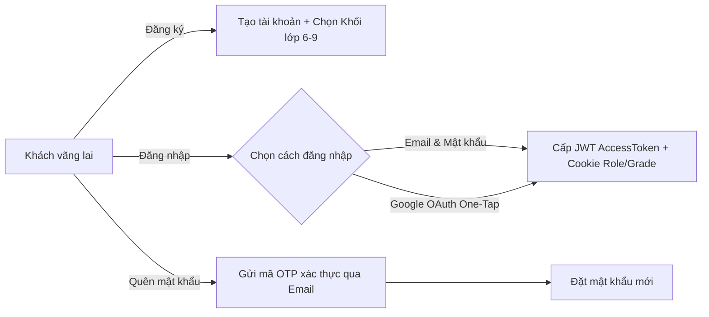
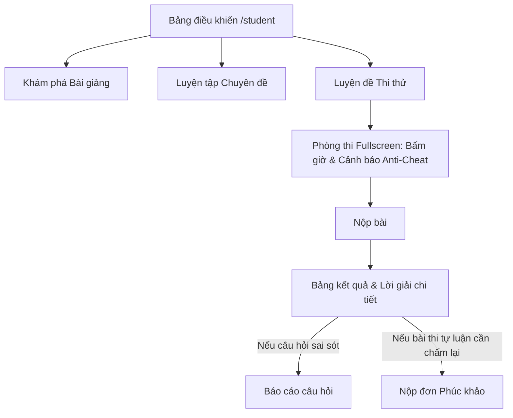
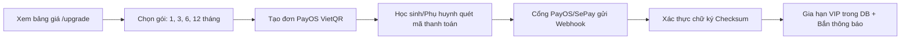
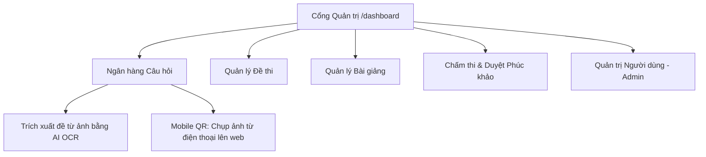

# Tài liệu Toàn bộ các Luồng hoạt động trong Hệ thống toan6789.vn (Application Flows)

> **Cập nhật lần cuối:** 15/10/2026  
> **Dự án:** toan6789.vn - Nền tảng Học và Luyện thi Toán THCS (Lớp 6, 7, 8, 9)

---

## Mục lục
1. [Luồng Xác thực & Tài khoản (Authentication & Account Flow)](#1-luồng-xác-thực--tài-khoản-authentication--account-flow)
2. [Luồng Học sinh (Student Experience Flow)](#2-luồng-học-sinh-student-experience-flow)
3. [Luồng Thanh toán & Gói cước tự động (Payment & VIP Flow)](#3-luồng-thanh-toán--gói-cước-tự-động-payment--vip-flow)
4. [Luồng Giáo viên & Quản trị viên (Teacher / Admin Flow)](#4-luồng-giáo-viên--quản-trị-viên-teacher--admin-flow)
5. [Luồng Tiện ích Đa thiết bị & Thông báo (Cross-Device & Notification Flow)](#5-luồng-tiện-ích-đa-thiết-bị--thông-báo-cross-device--notification-flow)

---

## 1. Luồng Xác thực & Tài khoản (Authentication & Account Flow)

### 1.1. Đăng ký tài khoản (`/register`)
- Người dùng điền đầy đủ thông tin: **Họ và tên**, **Email**, **Mật khẩu** và **Khối lớp học tập** (Lớp 6, 7, 8 hoặc 9).
- Hệ thống mã hóa mật khẩu bằng thuật toán an toàn (Bcrypt), khởi tạo tài khoản với vai trò mặc định là `student`.

### 1.2. Đăng nhập hệ thống (`/login`)
Hệ thống hỗ trợ 2 phương thức đăng nhập chính thức:
1. **Đăng nhập truyền thống**: Nhập Email và Mật khẩu. Hỗ trợ tính năng "Ghi nhớ đăng nhập".
2. **Đăng nhập Google OAuth (Google Sign-In)**: Đăng nhập nhanh 1 chạm bằng tài khoản Google. Tự động đồng bộ họ tên và email.
> ⚠️ **Quy định quan trọng về Telegram**: Tài khoản Telegram **không** dùng để đăng nhập vào hệ thống. Telegram được sử dụng độc quyền làm kênh liên kết nhận thông báo kết quả thi, cảnh báo bảo mật và tiến độ học tập cho Học sinh & Phụ huynh.

### 1.3. Quên mật khẩu & Khôi phục (`/forgot-password`)
- Nhập địa chỉ Email đã đăng ký -> Hệ thống gửi mã OTP 6 chữ số qua Email (`/api/v1/auth/forgot-password`).
- Xác thực mã OTP (`/api/v1/auth/verify-otp`) -> Thiết lập mật khẩu mới (`/api/v1/auth/reset-password`).

### 1.4. Quản lý Hồ sơ cá nhân (`/profile`)
- **Thông tin cơ bản**: Họ tên, Email, Vai trò, Khối lớp hiện tại (`/api/v1/users/me/grade`).
- **Avatar cá nhân**:
  - Hỗ trợ tải ảnh đại diện trực tiếp từ máy (`/api/v1/users/me/avatar`).
  - Nếu chưa có ảnh đại diện, hệ thống tự động sinh ký tự đại diện theo chuẩn danh xưng Việt Nam (lấy chữ cái đầu tiên của từ cuối cùng trong tên, ví dụ: "Nguyễn Văn Nam" -> chữ **N**).
- **Đổi mật khẩu tài khoản**: Nhập mật khẩu mới (tối thiểu 6 ký tự) và xác nhận (`/api/v1/users/me/password`).
- **Liên kết Telegram nhận thông báo**: Hỗ trợ 2 cổng liên kết riêng biệt cho Học sinh và Phụ huynh.
- **Quản lý hạn VIP**: Kiểm tra ngày kích hoạt, ngày hết hạn và lịch sử giao dịch.

---

## 2. Luồng Học sinh (Student Experience Flow)

### 2.1. Bảng điều khiển Học sinh (`/student`)
- **Theo dõi tiến độ học tập**: Phần trăm hoàn thành chỉ tiêu tuần, chuỗi ngày học liên tục (Streak 🔥).
- **Học tiếp & Luyện tiếp**: Danh sách bài giảng và đề thi đang làm dở dang.
- **Bảng xếp hạng tuần (Leaderboard)**: Top học sinh có điểm số cao nhất và tốc độ giải bài nhanh nhất.

### 2.2. Học bài giảng chuyên sâu (`/lectures` -> `/lectures/lop/[grade]`)
- Duyệt bài giảng chuẩn khung chương trình Bộ Giáo dục từ Lớp 6 đến Lớp 9.
- Nội dung bài học tích hợp công thức Toán học định dạng LaTeX (KaTeX) chuẩn xác.
- **Đánh dấu (Bookmark)**: Lưu bài giảng vào danh sách yêu thích để ôn tập lại (`/api/v1/lectures/:id/bookmark`).
- Thực hành bài tập đính kèm cuối mỗi bài giảng để củng cố lý thuyết.

### 2.3. Luyện tập câu hỏi tự do (`/practices` -> `/practices/lop/[grade]`)
- Luyện giải ngân hàng câu hỏi theo từng chuyên đề: Đại số, Hình học, Thống kê & Xác suất.
- Lọc theo 4 mức độ nhận thức: Nhận biết, Thông hiểu, Vận dụng, Vận dụng cao.
- Xem phản hồi đúng/sai tức thì sau khi chọn đáp án.

### 2.4. Thi thử & Luyện đề thực chiến (`/exams` -> `/exams/lop/[grade]`)
- **Danh sách đề thi**: Tự động hiển thị các đề thi tương ứng với khối lớp của học sinh (Lớp 6, 7, 8 hoặc 9) và cho phép chuyển nhanh giữa các khối lớp.
- **Cấu trúc đề thi**: Hiển thị thời gian làm bài (60 phút / 90 phút), số lượng câu hỏi, số lượt đã thi và điểm trung bình.

### 2.5. Trải nghiệm Phòng thi thực chiến (`/exam/[id]/take`)
- **Giao diện toàn màn hình (Fullscreen Exam Mode)**: Ẩn thanh điều hướng và menu để tránh xao nhãng.
- **Đồng hồ đếm ngược thời gian thực**: Tự động lưu tiến độ làm bài và tự động nộp bài khi hết giờ.
- **Hỗ trợ đa dạng loại câu hỏi**: Câu trắc nghiệm 1 đáp án, câu hỏi nhiều đáp án, câu tự luận nhập văn bản.
- **Popup giải thích (Explanation Popup)**: Cho phép học sinh viết nháp hoặc ghi chú lập luận cho từng câu hỏi trước khi chốt đáp án.
- **Cắm cờ câu hỏi (Flag)**: Đánh dấu các câu chưa chắc chắn để quay lại rà soát trước khi nộp.
- **Giám sát chống gian lận (Anti-Cheat Monitoring)**: Khi học sinh chuyển tab hoặc thu nhỏ trình duyệt, hệ thống kích hoạt cảnh báo và tự động ghi nhận số lần vi phạm (`/api/v1/notifications/cheat`).

### 2.6. Bảng kết quả & Lời giải chi tiết (`/exam/[id]/result`)
- **Tổng kết điểm số**: Điểm số đạt được (thang 10), phần trăm chính xác, thời gian hoàn thành.
- **Phân tích chi tiết từng câu**: Đối chiếu đáp án của học sinh với đáp án đúng của hệ thống.
- **Lời giải chi tiết (Step-by-step Solution)**: Hiển thị đầy đủ phương pháp giải, công thức và mẹo tính nhanh.
- **Báo cáo sai sót câu hỏi (`Report Question`)**: Gửi thông báo đến giáo viên nếu đề bài hoặc đáp án có nhầm lẫn.
- **Phúc khảo bài thi (`Appeal Exam Result`)**: Gửi đơn khiếu nại kèm lý do đối với các bài thi tự luận hoặc câu hỏi gây tranh cãi (`/api/v1/exam-results/:id/appeal`).

---

## 3. Luồng Thanh toán & Gói cước tự động (Payment & VIP Flow)

### 3.1. Chọn gói cước (`/upgrade`)
- Cung cấp các gói dịch vụ linh hoạt: Gói 1 tháng, Gói 3 tháng, Gói 6 tháng và Gói 1 năm.
- Quyền lợi thành viên VIP: Mở khóa toàn bộ ngân hàng đề thi chất lượng cao, xem lời giải chi tiết không giới hạn, không giới hạn lượt thi thử.

### 3.2. Thanh toán mã QR tự động (PayOS)
- Học sinh nhấn "Nâng cấp ngay" -> Hệ thống gọi API PayOS (`/api/v1/payments/create`) sinh mã thanh toán VietQR chuẩn Napas kèm nội dung chuyển khoản tự động duy nhất.
- Học sinh/Phụ huynh mở ứng dụng ngân hàng quét mã QR thanh toán trong vài giây.

### 3.3. Xử lý Webhook & Kích hoạt tức thì
- Cổng PayOS/SePay gọi về Webhook của hệ thống (`/webhook/payos` hoặc `/webhook/sepay`).
- Hệ thống giải mã và xác thực chữ ký bảo mật (Checksum):
  - Khớp mã đơn hàng -> Cập nhật trạng thái `PAID`.
  - Tự động cộng ngày sử dụng vào trường `expiresAt` của người dùng.
  - Tự động bắn thông báo chúc mừng nâng cấp thành công vào ứng dụng và qua Telegram (nếu đã liên kết).

---

## 4. Luồng Giáo viên & Quản trị viên (Teacher / Admin Flow)

### 4.1. Quản lý Ngân hàng Câu hỏi (`/dashboard/questions`, `/dashboard/questions/create`)
- **Tạo câu hỏi phong phú**: Trắc nghiệm đơn, trắc nghiệm nhiều lựa chọn, câu hỏi tự luận.
- **Trình soạn thảo công thức Toán học LaTeX trực quan**: Hỗ trợ ký hiệu Toán học, phân số, căn thức, ma trận, hệ phương trình.
- **Đồng bộ ảnh chụp từ điện thoại (Mobile QR Upload)**: Web sinh mã QR, giáo viên dùng điện thoại quét mã để chụp ảnh đề bài hoặc hình vẽ và ảnh tự động hiển thị trong ô soạn thảo trên web.
- **AI OCR (`/api/v1/ocr`)**: Tải ảnh tài liệu scan/chụp, hệ thống sử dụng AI nhận diện và trích xuất chữ viết cùng công thức Toán học vào đề bài.
- **Quản lý câu hỏi bị báo cáo lỗi (`/dashboard/questions/reported`)**: Xem phản ánh từ học sinh, chỉnh sửa câu hỏi hoặc đóng báo cáo sau khi xử lý.

### 4.2. Quản lý Bài giảng (`/dashboard/lectures`, `/dashboard/lectures/create`)
- Soạn thảo tài liệu lý thuyết chuẩn chương trình Bộ Giáo dục.
- Đính kèm bài tập thực hành theo từng bài giảng để học sinh rèn luyện.

### 4.3. Quản lý Đề thi (`/dashboard/exams`, `/dashboard/exams/create`)
- Thiết lập cấu trúc đề: Tên đề, Khối lớp (6-9), Thời gian làm bài (phút), Điểm đạt, Trạng thái (Bản nháp / Xuất bản).
- Chọn lọc câu hỏi từ ngân hàng câu hỏi để đưa vào đề thi.
- Kiểm tra và dọn dẹp các câu hỏi mồ côi (`Check Orphan Questions`).

### 4.4. Chấm thi & Xử lý Khiếu nại Phúc khảo (`/dashboard/tests`, `/dashboard/appeals`)
- **Chấm bài tự luận (`Needs Review`)**: Giáo viên đọc bài làm tự luận của học sinh và cho điểm thủ công.
- **Xử lý đơn phúc khảo (`Appeals`)**: Xem lý do khiếu nại của học sinh -> Duyệt (cập nhật lại điểm số) hoặc Từ chối kèm phản hồi giải thích.

### 4.5. Quản trị Người dùng (`/dashboard/users`) *(Dành riêng cho Admin)*
- Danh sách tài khoản: Tìm kiếm, lọc theo vai trò (Admin, Teacher, Student) và khối lớp.
- Khóa / Mở khóa tài khoản người dùng (`/api/v1/users/:id/status`).
- Nạp tiền / Cộng ngày sử dụng gói VIP thủ công cho học sinh (`/api/v1/users/:id/recharge`).

### 4.6. Quản lý Bài viết & Tin tức (`/dashboard/blog/create`, `/blog`)
- Đăng tải bài viết hướng dẫn phương pháp giải Toán, tài liệu ôn thi vào lớp 10, tin tức thi cử.

---

## 5. Luồng Tiện ích Đa thiết bị & Thông báo (Cross-Device & Notification Flow)

### 5.1. Đồng bộ Camera Điện thoại qua mã QR (Mobile QR Sync)
- **Mục đích**: Hỗ trợ giáo viên và học sinh tải ảnh vẽ hình học hoặc bài làm viết tay lên hệ thống nhanh chóng mà không cần cáp nối hoặc gửi file qua mạng xã hội.
- **Cơ chế**:
  1. Trình duyệt trên máy tính tạo phiên tải ảnh (`sessionId`) và sinh mã QR.
  2. Mở điện thoại quét mã QR -> Trình duyệt điện thoại mở camera chụp ảnh trực tiếp.
  3. Bấm tải lên -> Server tiếp nhận tại `/api/v1/mobile-upload/:sessionId`.
  4. Màn hình máy tính tự động nhận ảnh và chèn vào bài làm/câu hỏi ngay lập tức.

### 5.2. Hệ thống Thông báo Đa kênh (Notification Flow)
1. **Thông báo Trong Ứng dụng (In-app Notification)**:
   - Hiển thị qua biểu tượng chuông thông báo trên thanh điều hướng.
   - Nhận thông báo khi: Bài thi tự luận đã được chấm xong, kết quả đơn phúc khảo được duyệt, tài khoản được gia hạn VIP thành công.
2. **Kênh Thông báo Telegram (Telegram Notification Bot)**:
   - **Tài khoản Học sinh**: Nhận kết quả bài thi tức thì kèm bảng điểm, thông báo bài học mới.
   - **Tài khoản Phụ huynh**: Nhận báo cáo tiến độ học tập của con, thông báo kết quả các kỳ thi thử và nhắc nhở thời hạn gói học tập.
