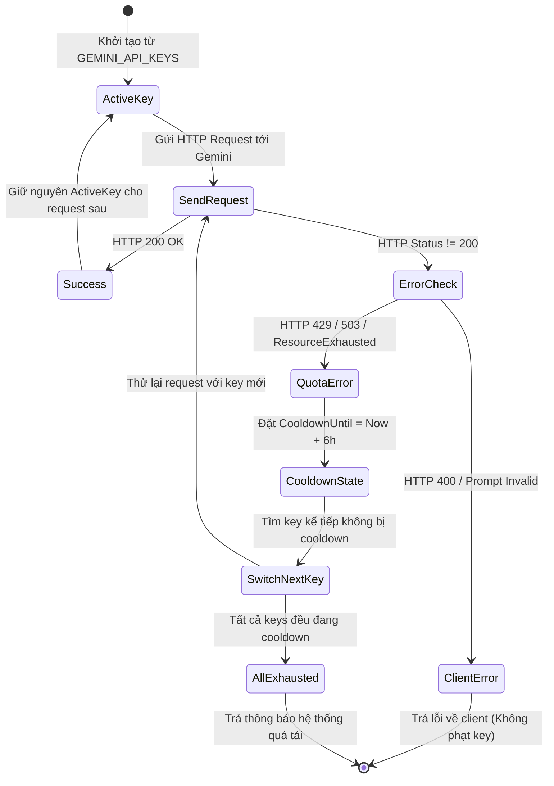

# Đặc tả Thiết kế: Cơ chế Xoay vòng & Cooldown Key Gemini (Gemini Key Pool Manager)

> **Mã đặc tả:** `2026-10-25-gemini-key-pool-rotation-design`  
> **Trạng thái:** Sẵn sàng thực thi (Ready for Planning)  
> **Tác giả:** Antigravity & User  
> **Ngày tạo:** 25/10/2026  

---

## 1. Bối cảnh & Lý do (Intent & The Why)

Hệ thống **toan6789.vn** sử dụng mô hình Google Gemini để vận hành 5 dịch vụ cốt lõi:
1. `ai_grader.go`: Chấm bài thi tự luận từng bước theo rubric.
2. `ocr_service.go`: Nhận diện đề thi và công thức Toán học từ hình ảnh scan/chụp.
3. `question_extractor.go`: Bóc tách câu hỏi từ tệp tài liệu văn bản/Word.
4. `lecture_extractor.go`: Bóc tách bài giảng theo chuẩn khung chương trình.
5. `geometry_visualizer_service.go`: Phân tích và sinh mã vẽ hình học trực quan.

**Vấn đề hiện tại:**
Cả 5 dịch vụ đều đang đọc trực tiếp một biến môi trường `GEMINI_API_KEY` duy nhất. Khi tài khoản chính (dù là gói Pro hay Flash) chạm ngưỡng hạn mức giới hạn (Rate Limit / Quota Exceeded - mã lỗi HTTP 429 hoặc RESOURCE_EXHAUSTED), toàn bộ các tính năng AI lập tức bị tê liệt, gây lỗi cho học sinh nộp bài hoặc giáo viên soạn đề.

**Mục tiêu giải pháp:**
Xây dựng module điều phối tập trung **Gemini Key Pool Manager** lưu trữ in-memory trong backend Go:
- Sử dụng tuần tự cố định (Sticky Key): Luôn dùng một key chính cho đến khi gặp lỗi.
- Tự động bắt lỗi hạn mức (HTTP 429 / 503 / Quota Exceeded), đánh dấu key lỗi vào trạng thái **nghỉ (cooldown) đúng 6 tiếng**.
- Lập tức chuyển sang key tiếp theo trong danh sách và thực hiện lại yêu cầu (failover retry) một cách trong suốt với người dùng.
- Sau 6 tiếng, key tự động được mở khóa và sẵn sàng tái hòa nhập vòng quay khi đến lượt.

---

## 2. Mục tiêu & Giới hạn (Goals & Non-Goals)

### Mục tiêu (Goals):
- **Cấu hình linh hoạt:** Đọc danh sách key từ `GEMINI_API_KEYS="key1,key2,key3"` trong `.env`, đồng thời vẫn hỗ trợ tương thích ngược nếu chỉ khai báo `GEMINI_API_KEY`.
- **Cơ chế Sticky Sequential:** Mọi yêu cầu đều ưu tiên dùng `Key[i]` đang hoạt động; không xoay luân phiên per-request (tránh phân tán quota không cần thiết).
- **Phân loại lỗi chính xác:** Chỉ kích hoạt cooldown 6 tiếng khi gặp lỗi hạn mức hoặc server quá tải từ Google (`HTTP 429`, `HTTP 503`, `"RESOURCE_EXHAUSTED"`, `"Quota exceeded"`, `"rateLimitExceeded"`). Các lỗi dữ liệu từ client (`HTTP 400 Bad Request`, prompt sai định dạng) tuyệt đối **không** phạt key.
- **Failover trong suốt:** Khi key hiện tại dính lỗi 429, hệ thống tự động khóa key đó, lấy key kế tiếp và retry request đó ngay lập tức (tối đa bằng số lượng key khả dụng trong pool). Người dùng không nhận thấy lỗi.
- **In-Memory Thread-Safe:** Quản lý trạng thái bằng `sync.RWMutex` trong bộ nhớ RAM của Go; cực nhanh, không phụ thuộc Redis, tự dọn dẹp an toàn khi khởi động lại.
- **Xử lý kịch bản cạn kiệt (Exhaustion Handling):** Nếu tất cả các key đều đang trong thời gian nghỉ, trả về thông báo lỗi tiếng Việt thân thiện: *"Hệ thống AI đang tạm thời quá tải hạn mức, vui lòng thử lại sau ít phút"* và log cảnh báo lỗi mức ERROR.
- **Kiểm thử chặt chẽ (Strict TDD):** Đầy đủ Unit Tests kiểm thử các trường hợp chuyển key, cooldown 6 giờ, tự phục hồi sau thời gian nghỉ, và kịch bản toàn bộ key đều chết.

### Giới hạn & Chống mục tiêu (Non-Goals & Anti-Goals):
- **Non-Goal:** Không lưu trữ trạng thái key trên Redis hoặc PostgreSQL (đã thống nhất tinh gọn In-Memory).
- **Non-Goal:** Chưa làm giao diện Dashboard cấu hình key trên Web Admin trong giai đoạn này (cấu hình qua `.env` là đủ).
- **Anti-Goal:** Không áp dụng Round-Robin per-request (đáp ứng đúng yêu cầu "dùng lần lượt, khi key1 lỗi mới chuyển sang key2").
- **Anti-Goal:** Không áp dụng cooldown nếu lỗi xuất phát từ phía client (HTTP 400, dữ liệu rỗng, timeout do mạng local).

---

## 3. Kiến trúc Kỹ thuật & Cấu trúc Dữ liệu

### 3.1. Cấu trúc Trạng thái (In-Memory Structs)

Vị trí đề xuất: `backend/internal/utils/gemini_pool.go` (độc lập tầng, không gây import cycle):

```go
package utils

import (
	"sync"
	"time"
)

type KeyState struct {
	Key           string
	CooldownUntil time.Time
	FailCount     int
	TotalSuccess  int64
}

type GeminiPoolManager struct {
	mu             sync.RWMutex
	keys           []*KeyState
	currentIndex   int
	cooldownPeriod time.Duration // Mặc định 6 * time.Hour
}
```

### 3.2. Vòng đời Xử lý (State Transition & Execution Flow)



### 3.3. Các hàm chức năng chính (Core APIs)

1. `NewGeminiPoolManager(keysStr string, cooldown time.Duration) *GeminiPoolManager`:
   - Phân tích chuỗi keys phân tách bằng dấu phẩy (bỏ qua khoảng trắng và các key rỗng).
   - Nếu `GEMINI_API_KEYS` rỗng, fallback về `GEMINI_API_KEY`.
2. `GetActiveKey() (string, error)`:
   - Trả về key hiện tại nếu không bị cooldown.
   - Nếu key hiện tại đã hết hạn cooldown (`time.Now().After(CooldownUntil)`), tự động gỡ cờ cooldown.
   - Nếu key hiện tại đang trong cooldown, tìm tuần tự key kế tiếp hợp lệ.
   - Nếu tất cả đều đang cooldown, trả về lỗi `ErrAllGeminiKeysExhausted`.
3. `MarkKeyFailure(key string, statusCode int, responseBody string) bool`:
   - Kiểm tra xem lỗi có thuộc diện Quota/Rate-limit hay không (`IsQuotaError(statusCode, responseBody)`).
   - Nếu đúng: đặt `CooldownUntil = time.Now().Add(m.cooldownPeriod)` và tăng `currentIndex` sang key kế tiếp. Trả về `true`.
   - Nếu sai (lỗi 400): không khóa key, trả về `false`.
4. `ExecuteWithRetry(executeFunc func(apiKey string) (*http.Response, error)) (*http.Response, error)`:
   - Hàm wrapper tự động hoá: Lấy key -> thực thi `executeFunc` -> nếu gặp lỗi quota thì gọi `MarkKeyFailure` -> tự động thử lại với key kế tiếp cho đến khi thành công hoặc cạn kiệt key.

---

## 4. Kế hoạch Tích hợp vào 5 Dịch vụ Backend

Toàn bộ 5 services sẽ được cập nhật để sử dụng `utils.GlobalGeminiPool.ExecuteWithRetry(...)` hoặc lấy key qua `utils.GlobalGeminiPool.GetActiveKey()`:

1. **`backend/internal/services/ai_grader.go`**:
   - Thay thế việc đọc `os.Getenv("GEMINI_API_KEY")` đơn lẻ.
   - Khi hàm `gradeEssayChunk` hoặc `gradeStepByStepChunk` gọi API bị lỗi 429, `GlobalGeminiPool` sẽ tự động nhảy sang key dự phòng và chấm lại mà không làm rớt worker `grading_worker.go`.
2. **`backend/internal/services/ocr_service.go`**:
   - Chuyển `RecognizeMathFromImage` sang dùng pool.
3. **`backend/internal/services/question_extractor.go`**:
   - Chuyển tiến trình bóc tách đề thi sang dùng pool.
4. **`backend/internal/services/lecture_extractor.go`**:
   - Chuyển bóc tách bài giảng sang dùng pool.
5. **`backend/internal/services/geometry_visualizer_service.go`**:
   - Chuyển dịch vụ vẽ hình học sang dùng pool.

---

## 5. Tiêu chuẩn Nghiệm thu (Acceptance Criteria)

- [x] **AC-1:** File `.env.example` và hệ thống nạp được `GEMINI_API_KEYS="key1,key2,key3"`, tương thích ngược với cấu hình 1 key cũ.
- [x] **AC-2:** Key 1 được dùng liên tục cho các request thành công (không bị nhảy key sau mỗi request).
- [x] **AC-3:** Khi mock response trả về HTTP 429 hoặc `RESOURCE_EXHAUSTED`, Key 1 lập tức chuyển sang trạng thái cooldown với hạn nghỉ đúng 6 tiếng (`cooldownPeriod`).
- [x] **AC-4:** Request bị lỗi 429 được tự động chuyển ngay sang Key 2 và hoàn tất thành công.
- [x] **AC-5:** Lỗi HTTP 400 (Bad Request) không kích hoạt cooldown cho key.
- [x] **AC-6:** Giả lập tua nhanh thời gian qua 6 tiếng (`mock time` / `cooldown expired`), Key 1 tự động phục hồi và có thể được sử dụng lại.
- [x] **AC-7:** Khi tất cả keys đều bị cooldown, hệ thống trả về lỗi tiếng Việt chuẩn xác và không panic/crash.
- [x] **AC-8:** 100% Unit test cho `GeminiPoolManager` pass, kiểm tra race condition với cờ `-race`.
