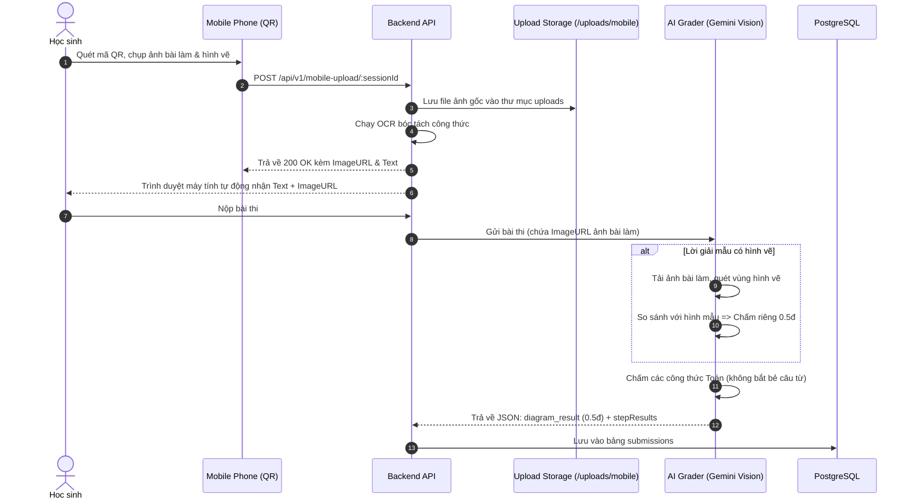

# Đặc tả Thiết kế: Chấm điểm Hình vẽ Độc lập (0.5đ) & Ưu tiên Công thức Toán học Tự luận

> **Mã đặc tả:** `2026-10-25-geometry-diagram-and-formula-grading-design`  
> **Trạng thái:** Sẵn sàng thực thi (Ready for Planning)  
> **Tác giả:** Antigravity Pair Programmer & Người dùng  
> **Ngày tạo:** 25/10/2026  

---

## 1. Bối cảnh & Động lực (Intent & The Why)

Trong kỳ thi và kiểm tra môn Toán cấp THCS tại Việt Nam, bài toán Hình học có các đặc thù sư phạm quan trọng:
1. **Điểm vẽ hình (0.5 điểm):** Học sinh bắt buộc phải vẽ hình đúng theo giả thiết của đề bài. Đây là tiêu chí kiểm tra kỹ năng vẽ hình cơ bản, độc lập với phần chứng minh hay tính toán. Nếu vẽ đúng hình theo giả thiết đề bài, học sinh nhận trọn vẹn **0.5 điểm**.
2. **Ưu tiên công thức Toán học:** Phần làm bài chứng minh/tính toán cần tập trung vào **tính đúng đắn của các công thức, hệ thức, định lý và biến đổi đại số**. Tránh việc AI quá khắt khe trừ điểm của học sinh chỉ vì học sinh không viết các câu văn dẫn giải rườm rà (ví dụ: "Theo bài ra ta có", "Xét tam giác...", "Ta dễ dàng nhận thấy...").
3. **Hiện trạng hệ thống:**
   - Tính năng tải ảnh bài làm bằng điện thoại qua Mobile QR (`/api/v1/mobile-upload/:sessionId`) hiện chỉ bóc tách chữ qua OCR thuần và bỏ quên file ảnh gốc chứa hình vẽ.
   - Prompt chấm bài tự luận của Gemini (`ai_grader.go`) hiện chỉ đọc văn bản, chưa hỗ trợ chế độ đa phương thức (Multimodal) để "nhìn" hình vẽ của học sinh và chưa có tiêu chí chấm hình vẽ độc lập.

**Mục tiêu của giải pháp:**
Nâng cấp toàn diện luồng chấm bài tự luận để:
- Lưu trữ và chuyển tiếp ảnh chụp bài làm gốc từ điện thoại của học sinh vào dịch vụ AI Grader.
- AI (Gemini Vision) tự động đối chiếu hình vẽ của học sinh với hình vẽ mẫu trong lời giải; nếu vẽ đúng, tự động cho **0.5 điểm hình vẽ độc lập** (không gộp hay trừ bớt điểm của các câu con a, b, c).
- Cập nhật quy tắc chấm công thức: Chỉ chấm tính chính xác của các biểu thức, đẳng thức và số liệu; tuyệt đối không trừ điểm vì thiếu câu từ dẫn giải.

---

## 2. Các Quyết định Thiết kế (Design Decisions)

### A. Quyết định từ Người dùng (Theirs)
1. **Điều kiện chấm hình vẽ:** Áp dụng khi lời giải mẫu (`solutionGuide` hoặc câu hỏi) có hình vẽ minh họa.
2. **Quy tắc tính điểm hình vẽ:** Vẽ đúng hình theo giả thiết đề bài => Được **0.5 điểm**. Vẽ sai hoặc không vẽ hình => **0 điểm**.
3. **Tính độc lập:** Điểm vẽ hình 0.5 điểm là **một mục độc lập, tính riêng, không gộp vào bất kỳ câu hỏi con nào (câu a, câu b, câu c)**.
4. **Quy tắc chấm bài giải:** "Chấm điểm công thức không cần chấm điểm lời giải": AI đánh giá bài làm dựa trên công thức Toán học, hệ thức, phương trình, tỉ số; không trừ điểm nếu thiếu lời văn diễn đạt.

### B. Quyết định Kỹ thuật của Builder (My Calls)
1. **Vòng đời Lưu trữ Ảnh Hình vẽ (Temp -> Permanent):**
   - **Tải lên tạm thời:** Khi học sinh chụp hình vẽ từ điện thoại (Mobile QR với `type=diagram`), ảnh được lưu tạm tại `./uploads/temp/{sessionID}_diagram.jpg` và trả về URL `/uploads/temp/...`. Nếu học sinh bỏ thi giữa chừng, cronjob dọn dẹp temp tự động xóa file, không để rác hệ thống.
   - **Chuyển sang lưu trữ chính thức:** Khi học sinh **nộp bài thành công** (`SubmitExam`), backend tự động di chuyển file từ `./uploads/temp/` sang `./uploads/diagrams/{submissionId}_{questionId}.jpg` và cập nhật đường dẫn chính thức vào bài làm.
   - **Dọn dẹp định kỳ 15 tháng (`CleanupOldSubmissionsAndDiagrams`):** Thiết lập hàm dọn dẹp trong `cronjob.go` tự động quét và xóa sạch các file ảnh hình vẽ trong `./uploads/diagrams/` có tuổi thọ trên 15 tháng, đồng thời xóa sạch toàn bộ dữ liệu kết quả chấm thi (`submissions`) đã lưu trữ trên **15 tháng** (`created_at < time.Now().AddDate(0, -15, 0)`) trong PostgreSQL.
2. **Cấu trúc Dữ liệu `DiagramResult`:**
   - Bổ sung trường `StudentDiagramURL string` và `DiagramResult` vào kết quả chấm câu hỏi `models.QuestionAnswer` (lưu trữ trong `submissions.answers_json`):
     ```json
     "student_diagram_url": "/uploads/diagrams/sub123_q456.jpg",
     "diagram_result": {
       "has_diagram_required": true,
       "score": 0.5,
       "max_score": 0.5,
       "is_correct": true,
       "student_diagram_url": "/uploads/diagrams/sub123_q456.jpg",
       "explanation": "Hình vẽ đầy đủ các đỉnh A, B, C, đường cao AH và ký hiệu vuông góc chính xác theo giả thiết."
     }
     ```
3. **Nâng cấp Prompt Gemini Vision (`ai_grader.go`):**
   - Đọc file ảnh từ `student_diagram_url` nạp vào Gemini Vision `inlineData`.
   - Đối chiếu nét vẽ của học sinh với hình mẫu trong `solutionGuide`.
   - Nếu phát hiện hình vẽ đúng: gán `diagram_result.score = 0.5`, `is_correct = true`.
   - Bổ sung quy tắc công thức: Bỏ qua kiểm tra độ mượt mà của câu văn; chỉ tập trung vào ký hiệu LaTeX, tính đẳng thức và các bước suy luận toán học.
4. **Giao diện Hiển thị Kết quả (`/exam/[id]/result`):**
   - Khi câu hỏi có `diagram_result`, hiển thị một thẻ độc lập phía trên danh sách các câu hỏi con:
     * Tiêu đề: **Phần vẽ hình: 0.5 / 0.5 điểm** (hoặc 0.0 / 0.5 điểm nếu vẽ sai).
     * Nhận xét của AI về hình vẽ.
     * Nút xem lại ảnh vẽ hình của học sinh.

---

## 3. Kiến trúc Luồng Dữ liệu (Data Flow)



---

## 4. Mục tiêu, Giới hạn & Chống mục tiêu (Goals, Non-Goals, Anti-Goals)

### Mục tiêu (Goals):
- [x] Lưu trữ ảnh chụp bài làm từ điện thoại và gắn kết URL ảnh vào bài nộp của học sinh.
- [x] Tích hợp Gemini Vision để đối chiếu hình vẽ của học sinh với hình vẽ mẫu, chấm độc lập 0.5 điểm.
- [x] Đảm bảo điểm hình vẽ không gộp hay làm xáo trộn điểm của các câu con a, b, c.
- [x] Cập nhật Prompt chấm tự luận để chỉ chấm công thức, hệ thức Toán học; không trừ điểm câu chữ dẫn dắt.
- [x] Hiển thị thẻ "Phần vẽ hình" trực quan, tách biệt trên trang kết quả bài thi.

### Giới hạn (Non-Goals):
- Không chấm điểm một phần cho hình vẽ (ví dụ 0.25đ): Đúng hình nhận trọn 0.5đ, sai hình hoặc không vẽ nhận 0đ theo yêu cầu.
- Không yêu cầu giáo viên phải vẽ lại hình bằng tay; hệ thống dùng hình ảnh hoặc mã SVG đã có trong lời giải mẫu.

### Chống mục tiêu (Anti-Goals):
- Tuyệt đối không trừ điểm nếu học sinh giải bài theo phong cách ngắn gọn, súc tích chỉ gồm các công thức toán và phép tính.
- Không làm gãy giao diện đối với các câu hỏi đại số hoặc các bài thi cũ không có hình vẽ.

---

## 5. Tiêu chuẩn Nghiệm thu (Acceptance Criteria)

1. **AC-1:** Khi upload ảnh từ điện thoại qua `/api/v1/mobile-upload/:sessionId`, file ảnh được lưu an toàn tại `backend/uploads/mobile/` và trả về `imageUrls`.
2. **AC-2:** Bài làm tự luận gửi sang AI mang đầy đủ cả nội dung văn bản lẫn danh sách link ảnh đính kèm.
3. **AC-3:** Với câu hỏi hình học có hình mẫu, nếu học sinh có ảnh vẽ đúng hình => AI trả về `diagram_result` có `score = 0.5`, `max_score = 0.5`, `is_correct = true`.
4. **AC-4:** Với câu hỏi hình học có hình mẫu, nếu học sinh không vẽ hình hoặc vẽ sai => `diagram_result` có `score = 0.0`, `is_correct = false`.
5. **AC-5:** Điểm của các câu con a, b, c được tính độc lập và tổng điểm bài thi = Tổng điểm câu con + Điểm hình vẽ.
6. **AC-6:** Học sinh chỉ viết công thức biến đổi đúng (không có câu văn dẫn giải) vẫn nhận đủ 100% điểm của các bước công thức đó.
7. **AC-7:** Trang kết quả bài thi `/exam/[id]/result` hiển thị khối thông tin "Phần vẽ hình" sắc nét, rõ ràng và chuẩn thiết kế.
