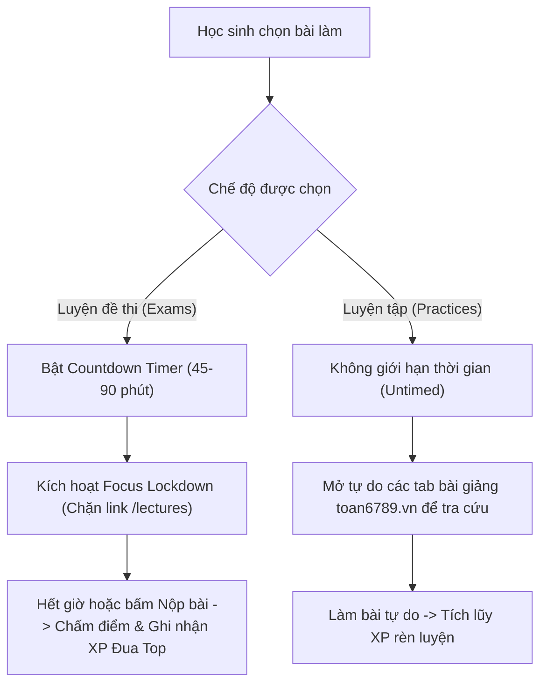
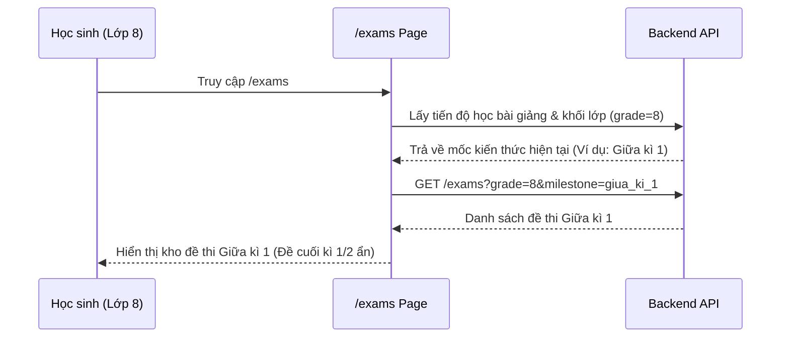

# Thiết Kế Hệ Thống Luyện Đề Thi (Exams) & Tối Ưu Bảng Xếp Hạng Trên Dashboard

**Ngày ban hành**: 30/10/2026  
**Trạng thái**: Đã phê duyệt (Approved via Brainstorming)  
**Tác giả**: AI Pair Programmer (Antigravity) & Trưởng dự án  

---

## 1. Bối cảnh & Mục đích (Intent & Why)

Trước đây:
- Đường dẫn Luyện đề thi (`/exams` và `/exams/lop/[grade]`) đang bị chuyển hướng nhầm sang trang Bài giảng (`/lectures`).
- Chưa có ranh giới rõ ràng giữa hai hình thức: **Làm đề thi thử** (kiểm tra nghiêm túc) và **Luyện tập tự do** (vừa làm vừa học).
- Trang Bảng xếp hạng (`/leaderboard`) bị bỏ ngỏ, gây phân mảnh trải nghiệm khi học sinh phải chuyển đổi giữa nhiều trang không cần thiết.

Mục đích thiết kế:
- Xây dựng lại trang Luyện đề thi (`/exams`) có cơ chế phân loại đề thi cuốn chiếu theo **tiến trình học thực tế của từng học sinh** bám sát chương trình Toán THCS GDPT 2018 theo khối lớp.
- Thiết lập 2 chế độ làm bài phân định rõ ràng: **Exams** (Thi thử bấm giờ, giám sát tập trung) và **Practices** (Luyện tập mở, không giới hạn thời gian).
- Tinh gọn cấu trúc điều hướng (loại bỏ `/leaderboard` riêng biệt), đưa toàn bộ cơ chế thi đua "Vinh danh & Động lực" về trang **Dashboard Học sinh (`/student`)** làm trung tâm chỉ huy duy nhất.

---

## 2. Mục tiêu, Phi mục tiêu & Rào cản (Goals, Non-goals & Anti-goals)

### 2.1. Mục tiêu (Goals)
1. **Phân định rõ 2 chế độ**:
   - `Exams`: Bấm giờ đếm ngược (45–90 phút), bật chế độ tập trung (khóa điều hướng sang bài giảng, nếu thoát trang sẽ cảnh báo/nộp bài).
   - `Practices`: Không tính giờ, cho phép mở song song các bài giảng cùng tên miền `toan6789.vn` để tra cứu công thức/lý thuyết.
2. **Lọc đề cuốn chiếu theo tiến độ bài học (Progress-based Milestone)**:
   - Hệ thống tự động xác định chặng học hiện tại (*Giữa kì 1 $\rightarrow$ Cuối kì 1 $\rightarrow$ Giữa kì 2 $\rightarrow$ Cuối kì 2*) dựa trên khối lớp và các bài giảng học sinh đang học.
   - Chỉ hiển thị các đề thi thuộc mốc hiện tại. Các đề thuộc mốc trước đã hoàn thành sẽ được ẩn khỏi danh sách chính để giữ giao diện tinh gọn.
3. **Thanh điều hướng tinh giản (3 trụ cột)**:
   - Sidebar và Mobile Bottom Nav chỉ giữ lại 3 mục: **Dashboard**, **Bài giảng**, **Luyện đề thi**.
4. **Vinh danh & Động lực tuần trên Dashboard**:
   - Tích hợp khối "Đường đua tuần" vào `StudentLeaderboard` trên `/student`, có đồng hồ chốt điểm 00:00 Thứ Hai và lời nhắc cá nhân hóa thứ hạng.
5. **Giao diện chuẩn M3 Outlined & Academic Elegance**:
   - Giữ vững các token chuẩn trong `DESIGN.md`: Không bóng đổ neon, cỡ chữ tối thiểu 12px, touch target $\ge 44\text{px}$.

### 2.2. Phi mục tiêu (Non-goals)
- Không xây dựng trang `/leaderboard` độc lập; loại bỏ router và link điều hướng tới trang này.
- Không lọc đề thi dựa theo tháng cố định trong năm; chỉ dựa trên tiến trình bài học thực tế của tài khoản học sinh.

### 2.3. Rào cản & Điều tối kỵ (Anti-goals & Constraints)
- **Tuyệt đối KHÔNG tự động deploy lên VPS**.
- **Không phá vỡ luồng thi hiện tại**: Các API `/api/v1/exams`, `/api/v1/submissions` vẫn hoạt động ổn định và kế thừa mã nguồn sẵn có.

---

## 3. Kiến trúc Chi tiết (Detailed Architecture & Decisions)

### 3.1. Phân định Chế độ Làm bài (Exams vs Practices)

### 3.2. Luồng Lọc Đề Cuốn Chiếu Theo Tiến Độ (Progress-based Milestone)

### 3.3. Tối ưu Dashboard Học sinh (`/student`)
1. **Header**:
   - Lời chào chuẩn hóa: `Chào bạn, {user.name}!` (thay thế *"Chào mừng trở lại"*).
2. **StudentProgressCard**:
   - Bổ sung huy hiệu chặng: `Chặng mục tiêu: Ôn thi Giữa kì 1`.
   - Bổ sung chỉ số chặng: `Hoàn thành {x}/{y} bài học • {z} đề thi thử`.
3. **StudentLeaderboard**:
   - Bổ sung khối "Đường đua tuần" có icon ngọn lửa, hạn chốt 00:00 Thứ Hai hàng tuần và lời nhắc bứt phá điểm XP.
4. **Trang Kết quả Đề thi (`/exam/[id]/result`)**:
   - Co ngắn thanh chuyển đổi lượt làm bài (`Lần 1`, `Lần 2`) và nút `Làm lại đề thi` về cùng một cụm (`justify-start gap-3 sm:gap-4`), loại bỏ khoảng trống thừa ở giữa.

---

## 4. Kế hoạch Triển khai (Implementation Steps)

1. **Giao diện Luyện đề thi (`/exams` & `/exams/lop/[grade]`)**:
   - Gỡ bỏ lệnh `redirect('/lectures')`.
   - Xây dựng component danh sách đề thi theo mốc (*Giữa kì 1, Cuối kì 1, Giữa kì 2, Cuối kì 2*) với bộ lọc tự động theo tiến độ bài học.
2. **Chế độ Focus Lockdown trong Exam Take**:
   - Bổ sung cờ `mode: 'exam' | 'practice'` trong giao diện làm bài `/exam/[id]/take`.
   - Khi ở `mode='exam'`, chặn thoát trang sang `/lectures` bằng dialog cảnh báo.
3. **Điều hướng**:
   - Xóa bỏ mục `Bảng xếp hạng` (`/leaderboard`) trong `Sidebar.tsx` và `StudentBottomNav.tsx`.
4. **Kiểm thử tự động (TDD)**:
   - Viết trọn vẹn unit test bằng Vitest cho trang `/exams` và các component liên quan, đảm bảo 100% pass trước khi nghiệm thu.

---

## 5. Quyết định Kỹ thuật Chi tiết (Builder Check Resolutions)

1. **Cơ chế xác định Chặng học & Hợp đồng Dữ liệu**:
   - Bảng `exams` trong Go backend đã có sẵn trường `type` (`'Giữa kì 1'`, `'Cuối kì 1'`, `'Giữa kì 2'`, `'Cuối kì 2'`, `'Chuyên Đề'`, `'Ôn tập'`) và `cate` (`'exam'`, `'practice'`).
   - Endpoint `GET /api/v1/exams?grade=...&type=...` đã hoạt động tốt $\rightarrow$ **Không cần migration CSDL**.
   - Thuật toán xác định chặng hiện tại (`determineCurrentMilestone`): Dựa vào các bài nộp đã làm (`mySubmissions`):
     - Chưa hoàn thành đề Giữa kì 1 $\rightarrow$ Mốc: `Giữa kì 1`.
     - Đã hoàn thành ít nhất 1 đề Giữa kì 1 $\rightarrow$ Mốc: `Cuối kì 1`.
     - Đã hoàn thành ít nhất 1 đề Cuối kì 1 $\rightarrow$ Mốc: `Giữa kì 2`.
     - Đã hoàn thành ít nhất 1 đề Giữa kì 2 $\rightarrow$ Mốc: `Cuối kì 2`.
2. **Kiến trúc Tab & Xem lại Đề thi cũ**:
   - Trang `/exams/lop/[grade]` tổ chức dạng Tabs:
     - Tab **Chặng hiện tại** (active mặc định, gắn huy hiệu `🎯 Đang học`), chỉ hiển thị các đề thi thuộc đúng chặng hiện tại của học sinh theo đúng nguyên tắc tập trung, gọn gàng.
     - Các Tab **Chặng khác**: Cho phép học sinh chủ động bấm vào xem lại đề các chặng cũ đã học qua để ôn tập.
     - Tab **Chuyên đề & Ôn tập**: Chứa các đề thuộc loại `Chuyên Đề`, `Ôn tập`, `HSG`.
3. **Phân biệt Chế độ Làm bài (`exam` vs `practice`)**:
   - Nhận diện trực tiếp từ thuộc tính `exam.cate`:
     - `exam.cate === 'practice'`: Chế độ Luyện tập $\rightarrow$ Không giới hạn giờ, đồng hồ bấm giờ tăng dần (count-up) hoặc ẩn, cho phép học sinh mở tab khác để tra cứu lý thuyết bài giảng.
     - `exam.cate === 'exam'`: Chế độ Thi thử $\rightarrow$ Có đồng hồ đếm ngược, kích hoạt Focus Lockdown & Anti-cheat.
4. **Hành vi Chống gian lận (Anti-cheat)**:
   - Ở chế độ `practice`: Tắt bỏ listener `document.hidden` để không phạt khi học sinh mở tab tra cứu kiến thức `toan6789.vn/lectures`.
   - Ở chế độ `exam`: Giữ nguyên listener `document.hidden` chống chuyển tab. Khi rời trang, hiển thị modal cảnh báo xác nhận nộp bài.
5. **Điều hướng Router `/leaderboard` và `/practices`**:
   - `/leaderboard`: Gỡ khỏi thanh điều hướng Sidebar và BottomNav, tạo redirect route `/leaderboard` $\rightarrow$ `/student`.
   - `/practices`: Giữ redirect hoặc alias sang `/exams?cate=practice` để đảm bảo tương thích ngược với các liên kết bài tập từ các trang bài giảng.
