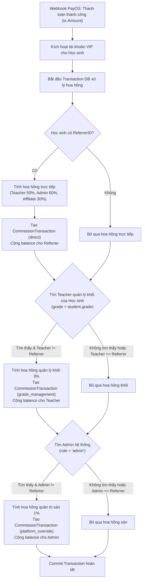

# Thiết kế Cập nhật Tỷ lệ Hoa hồng & Phân bổ Hoa hồng Quản lý Khối Lớp và Nền tảng (Multi-tier Commission)

## 1. Bối cảnh & Mục đích (Intent & Why)

Sau giai đoạn vận hành hệ thống Mã giới thiệu (GT Voucher) 1 cấp ban đầu, hệ thống cần nâng cấp chính sách dòng tiền hoa hồng nhằm:
1. **Khuyến khích giáo viên phụ trách khối lớp**: Giáo viên chịu trách nhiệm nội dung, giải đáp thắc mắc và kiểm duyệt bài giảng cho từng khối lớp (Lớp 6, 7, 8, 9) cần được hưởng một phần doanh thu quản lý (3%) từ mọi học sinh trong khối lớp đó, ngay cả khi học sinh không do giáo viên này trực tiếp tuyển sinh.
2. **Khuyến khích quản trị viên nền tảng**: Admin duy nhất vận hành toàn bộ hạ tầng kỹ thuật và nội dung được hưởng 1% doanh thu từ mọi học sinh trên toàn sàn không do Admin trực tiếp giới thiệu.
3. **Chuẩn hóa tỷ lệ hoa hồng trực tiếp**:
   - Giáo viên (Teacher) trực tiếp giới thiệu: **50%** (điều chỉnh từ 60%).
   - Quản trị viên (Admin) trực tiếp giới thiệu: **60%** (điều chỉnh từ 70%).
   - Cộng tác viên (Affiliate) trực tiếp giới thiệu: giữ nguyên **30%**.

---

## 2. Mục tiêu & Phi mục tiêu (Goals, Non-goals, Anti-goals)

### Mục tiêu (Goals)
1. **Tỷ lệ hoa hồng giới thiệu trực tiếp mới**:
   - Cập nhật `CommissionRateTeacher = 50.0` và `CommissionRateAdmin = 60.0` trong hệ thống.
   - Cập nhật voucher mặc định của các tài khoản Teacher và Admin mới và hiện có theo tỷ lệ mới.
2. **Hoa hồng quản lý khối lớp (3%)**:
   - Mỗi khi học sinh thuộc khối lớp nào nạp tiền/mua gói qua PayOS (ví dụ: Lớp 7), hệ thống tìm kiếm duy nhất 1 Giáo viên phụ trách khối lớp đó (`role = 'teacher' AND grade = '7' AND status = 'active'`).
   - Nếu tìm thấy Giáo viên và học sinh này **không phải** do chính Giáo viên đó trực tiếp giới thiệu:
     - Trích thưởng **3%** giá trị đơn hàng cộng vào `commission_balance` của Giáo viên.
     - Ghi nhận `CommissionTransaction` loại `grade_management` với ghi chú rõ ràng (VD: *"Hoa hồng quản lý Lớp 7"*).
3. **Hoa hồng quản trị sàn (1%)**:
   - Với mỗi giao dịch nạp tiền thành công của học sinh, hệ thống tìm tài khoản Admin duy nhất (`role = 'admin' AND status = 'active'`).
   - Nếu học sinh này **không phải** do Admin trực tiếp giới thiệu:
     - Trích thưởng **1%** giá trị đơn hàng cộng vào `commission_balance` của Admin.
     - Ghi nhận `CommissionTransaction` loại `platform_override` với ghi chú *"Hoa hồng quản trị sàn"*.
4. **Minh bạch hóa giao dịch hoa hồng**:
   - Phân loại rõ ràng loại hoa hồng trong cơ sở dữ liệu (`direct`, `grade_management`, `platform_override`).
   - Bảng lịch sử hoa hồng trên giao diện hiển thị huy hiệu (badge) rõ ràng để giáo viên và admin dễ dàng theo dõi nguồn thu.
5. **Bảo toàn tính toàn vẹn (Idempotency & Atomicity)**:
   - Toàn bộ việc ghi nhận hoa hồng trực tiếp và gián tiếp được thực thi trong một Database Transaction duy nhất khi PayOS gửi Webhook xác nhận thanh toán.
   - Đảm bảo tính duy nhất (idempotency): 1 đơn hàng (`order_code`) không bao giờ bị tính hoa hồng lặp lại.

### Phi mục tiêu (Non-goals)
- Không thay đổi quy trình chốt sổ định kỳ hàng tháng (vẫn chốt tự động vào `00:00:00` mùng 1 hàng tháng: `total_commission_received += commission_balance`, reset `commission_balance = 0`).
- Không thay đổi quyền lợi của học sinh khi nhập mã giới thiệu (vẫn nhận ưu đãi 1 tháng VIP miễn phí).
- Không hỗ trợ nhiều giáo viên cùng chia sẻ một khối lớp (mỗi khối lớp cố định 1 giáo viên phụ trách duy nhất).

### Anti-goals
- **Không cộng dồn chồng chéo hoa hồng trực tiếp và gián tiếp cho cùng 1 người**: Nếu học sinh Lớp 7 do chính Teacher Lớp 7 giới thiệu trực tiếp, Teacher này nhận đủ 50% trực tiếp, tuyệt đối **không** nhận thêm 3% gián tiếp. Tương tự, nếu học sinh do Admin trực tiếp giới thiệu, Admin nhận đủ 60% trực tiếp, tuyệt đối **không** nhận thêm 1% gián tiếp.
- **Không làm gián đoạn kích hoạt VIP**: Nếu việc trích thưởng hoa hồng gặp trục trặc, tài khoản VIP của học sinh vẫn phải được kích hoạt thành công (fail-safe).

---

## 3. Ràng buộc hệ thống & Giả định (Constraints & Invariants)

1. **Ràng buộc vai trò (Role Constraints)**:
   - Chỉ có **duy nhất 1 tài khoản Admin** trong toàn hệ thống.
   - Mỗi khối lớp (`6`, `7`, `8`, `9`) chỉ do **duy nhất 1 Giáo viên** đảm nhiệm.
2. **Chuẩn hóa chuỗi khối lớp (`Grade`)**:
   - Học sinh và Giáo viên lưu khối lớp dạng chuẩn: `"6"`, `"7"`, `"8"`, `"9"`. Nếu trong DB tồn tại tiền tố `"Lớp 7"`, hệ thống tự động chuẩn hóa sang `"7"` khi đối chiếu.
3. **Bảo mật và cô lập**:
   - Mọi thay đổi tuân thủ nghiêm ngặt ranh giới repo `/Users/modeptrai/Desktop/toan6789.vn`. Tuyệt đối không tự ý deploy lên VPS.

---

## 4. Thiết kế kỹ thuật chi tiết (Technical Specification)

### 4.1. Cơ sở dữ liệu (Database Schema)

#### Cập nhật bảng `commission_transactions`:
Bổ sung các trường để hỗ trợ nhiều giao dịch hoa hồng cho cùng một đơn hàng:
- `id`: `uuid` (Primary Key).
- `order_code`: `bigint` (Index, không unique vì 1 đơn hàng có thể tạo tối đa 3 giao dịch hoa hồng: trực tiếp, quản lý khối, quản trị sàn).
- `referrer_id`: `uuid` (Index, người nhận hoa hồng).
- `student_id`: `uuid` (Index, học sinh nạp tiền).
- `student_amount`: `bigint` (Số tiền học sinh thanh toán).
- `commission_rate`: `float32` (Tỷ lệ: 50.0, 60.0, 30.0, 3.0, 1.0).
- `commission_amount`: `bigint` (Số tiền hoa hồng nhận được bằng VNĐ).
- `commission_type`: `varchar(50)` (Mặc định `'direct'`, các giá trị: `'direct'`, `'grade_management'`, `'platform_override'`).
- `note`: `varchar(255)` (Mô tả hiển thị: VD: *"Hoa hồng giới thiệu trực tiếp"*, *"Hoa hồng quản lý Lớp 7"*, *"Hoa hồng quản trị sàn"*).
- `status`: `varchar(50)` (Mặc định `'pending'`, chuyển thành `'settled'` khi chốt sổ mùng 1).
- `created_at`, `updated_at`.

Unique composite index chống duplicate webhook: `idx_comm_order_referrer_type` trên `(order_code, referrer_id, commission_type)`.

---

### 4.2. Luồng xử lý dòng tiền tại Webhook PayOS (`webhook_handler.go`)

Khi nhận Webhook `PAID` từ PayOS cho đơn hàng có `orderCode` và số tiền `tx.Amount`:



---

### 4.3. Bảng kịch bản phân bổ dòng tiền mẫu

Giả sử Học sinh Lớp 7 nạp gói VIP **100.000 VNĐ**:

| Kịch bản tuyển sinh | Người trực tiếp giới thiệu | Hoa hồng trực tiếp | Teacher Lớp 7 (Quản lý 3%) | Admin (Quản trị 1%) | Tổng hoa hồng chi trả |
| :--- | :--- | :--- | :--- | :--- | :--- |
| **Kịch bản 1**: Học sinh tự đăng ký (không có mã GT) | Không có | 0 VNĐ (0%) | 3.000 VNĐ (3%) | 1.000 VNĐ (1%) | **4.000 VNĐ (4%)** |
| **Kịch bản 2**: Do Giáo viên Lớp 7 trực tiếp giới thiệu | Giáo viên Lớp 7 | 50.000 VNĐ (50%) | 0 VNĐ *(đã nhận 50%)* | 1.000 VNĐ (1%) | **51.000 VNĐ (51%)** |
| **Kịch bản 3**: Do Giáo viên Lớp 8 trực tiếp giới thiệu | Giáo viên Lớp 8 | 50.000 VNĐ (50%) | 3.000 VNĐ (3%) | 1.000 VNĐ (1%) | **54.000 VNĐ (54%)** |
| **Kịch bản 4**: Do Admin trực tiếp giới thiệu | Admin | 60.000 VNĐ (60%) | 3.000 VNĐ (3%) | 0 VNĐ *(đã nhận 60%)* | **63.000 VNĐ (63%)** |
| **Kịch bản 5**: Do Cộng tác viên (Affiliate) giới thiệu | Cộng tác viên | 30.000 VNĐ (30%) | 3.000 VNĐ (3%) | 1.000 VNĐ (1%) | **34.000 VNĐ (34%)** |

---

### 4.4. Cập nhật mã nguồn chi tiết

1. **`backend/internal/services/referral_service.go`**:
   - Cập nhật các hằng số:
     ```go
     const (
         CommissionRateTeacher   float32 = 50.0 // Giảm từ 60%
         CommissionRateAdmin     float32 = 60.0 // Giảm từ 70%
         CommissionRateAffiliate float32 = 30.0 // Giữ nguyên
         CommissionRateGrade     float32 = 3.0  // Hoa hồng quản lý khối
         CommissionRatePlatform  float32 = 1.0  // Hoa hồng quản trị sàn
     )
     ```
   - Thêm helper:
     - `NormalizeGrade(grade string) string` để chuẩn hóa các chuỗi khối lớp (`"Lớp 7"` -> `"7"`).
     - `GetTeacherForGrade(db *gorm.DB, grade string) (*models.User, error)`.
     - `GetSystemAdmin(db *gorm.DB) (*models.User, error)`.
2. **`backend/internal/models/commission_transaction.go`**:
   - Thêm `CommissionType string` (`"direct"`, `"grade_management"`, `"platform_override"`).
   - Thêm `Note string` (Mô tả ngắn gọn).
3. **`backend/internal/handlers/webhook_handler.go`**:
   - Thay thế hàm đơn cấp cũ bằng hàm xử lý đa tầng atomic:
     `processMultiTierCommissions(tx *models.PaymentTransaction, student *models.User)`
4. **`frontend/src/app/(main)/dashboard/affiliate/` hoặc trang cài đặt hoa hồng**:
   - Hiển thị cột "Loại hoa hồng" với huy hiệu trực quan:
     - Xanh lá: *Trực tiếp (50% / 60%)*
     - Xanh dương: *Quản lý khối (3%)*
     - Tím: *Quản trị sàn (1%)*

---

## 5. Kế hoạch kiểm thử (Test Plan)

1. **Unit tests Backend**:
   - `TestWebhook_DirectCommission_Teacher`: Học sinh do Teacher giới thiệu $\rightarrow$ Teacher nhận 50%, Admin nhận 1%, Teacher khối nhận 0%.
   - `TestWebhook_DirectCommission_Admin`: Học sinh do Admin giới thiệu $\rightarrow$ Admin nhận 60%, Teacher khối nhận 3%, Admin nhận 0% gián tiếp.
   - `TestWebhook_IndirectOnly_NoReferrer`: Học sinh không có mã $\rightarrow$ Teacher khối nhận 3%, Admin nhận 1%.
   - `TestWebhook_AffiliateReferral`: Học sinh do CTV giới thiệu $\rightarrow$ CTV nhận 30%, Teacher khối nhận 3%, Admin nhận 1%.
   - `TestWebhook_Idempotency`: Gửi webhook 2 lần cùng `orderCode` $\rightarrow$ Số dư không bị cộng lặp.
2. **Frontend UI Verification**:
   - Render bảng lịch sử giao dịch với 3 loại badge hoa hồng.
   - Kiểm tra `npm test` và `tsc --noEmit`.
